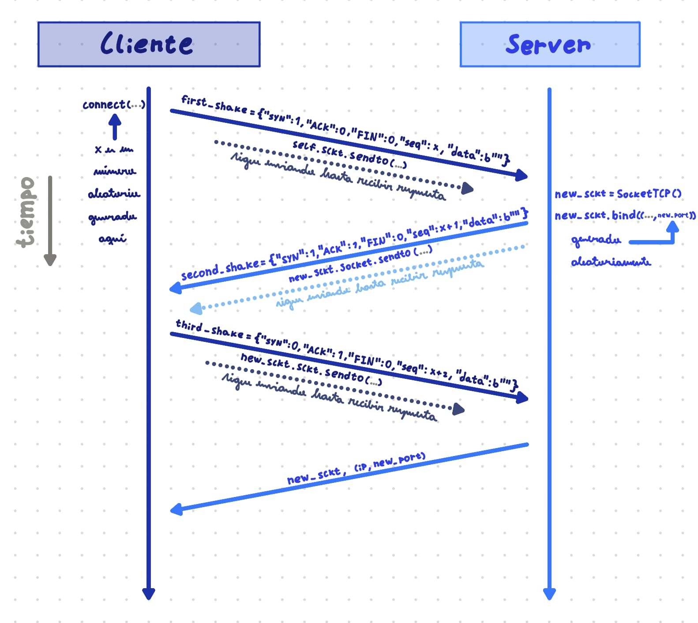
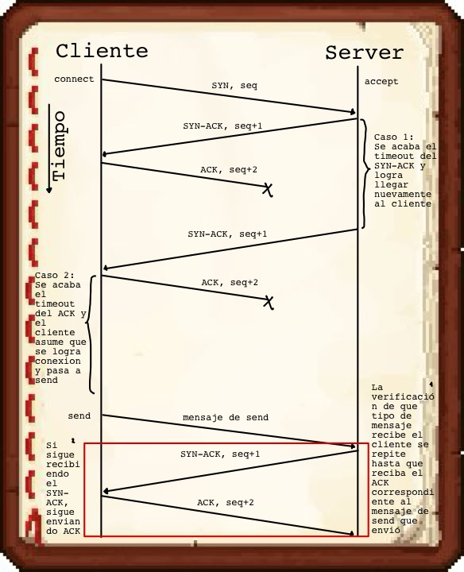

# Actividad 1 - Control 2 - CC4303 Redes

Link del repositorio en GitHub: [Repositorio](https://github.com/0scar76/Actividad-1-control-2.git)

**En esta actividad únicamente se utilizó la inteligencia artificial para ver firmas de funciones.**

## Integrantes:
* **Oscar Conejeros Bruce**
* **Julio Yáñez**

## Sobre la actividad

En esta actividad, se pidió crear la clase socketTCP, que simula el comportamiento de la versión simplificada de TCP, usando Stop & Wait. Para esto, se usaron sockets UDP de la librería socket de Python, junto a su función settimeout y manejo de errores para soportar las pérdidas.

### Prerrequisitos

Para esta actividad no hay prerrequisitos, ya que todas las librerías ocupadas (socket y sys) vienen ya incluidas con Python por defecto.

## Cómo ejecutar las pruebas

Para las pruebas con pérdidas, se ejecutó el comando netem dado en el enunciado de la actividad.

El repositorio incluye dos archivos .py, los cuales se ocuparon como tests:
* Server.py
* Cliente.py

Para ejecutar las pruebas incluidas, se deben ejecutar **ambos** archivos de la siguiente manera (argumento opcional -d o --debug sirve para activar el modo debug, que imprime mensajes enviados, recibidos y estados de los sockets):
```
python3 <nombre_del_archivo_.py> <IP_SERVER> <PORT_SERVER> [-d | --debug] < <nombre_del_archivo_a_enviar>
```
El repositorio incluye un archivo test.txt de largo 38 (el largo del archivo es más grande que el buffer que se utiliza en la prueba de archivo y, en este caso específico, el largo no es múltiplo de 16), pero puede incluso probarse dándole este README.md si se ajusta la variable **BYTES_NUM** dentro del archivo **socketTCP.py** a 2.

**IMPORTANTE:** Es necesario ejecutar ambos archivos .py con los mismos argumentos (a excepción del debug, que es opcional), ya que de otra forma el test **no funcionará**.

## Decisiones creativas

En esta actividad, para la creación de los segmentos TCP, se optó por utilizar 1 byte para las flags SYN, ACK y FIN, 4 bytes para el número de secuencia seq y los bytes restantes para el campo de datos.
Sumado a esto, la estructura de datos elegida para el parser fue un **diccionario**, ya que facilitó la verificación de los flags recibidos/enviados en los mensajes, la creación de los mensajes para las diferentes funciones de la clase y la separación de los distintos campos de interés.

Como en esta versión de TCP no se consideraron conexiones rechazadas, se decidió implementar los sockets de tal manera que, a excepción de **close** y **recv_close**, los mensajes se envíen y traten de recibir eternamente, es decir, se asume que eventualmente se va a lograr la conexión entre server y cliente y eventualmente los mensajes llegarán a destino al hacer recv y send.

En la función **close** y **recv_close** se utilizó la misma función close para cerrar ambos lados de la conexión, con un método para verificar quién es el que envía el primer mensaje FIN y quién lo recibe. En el caso de que ambos lados envíen el mensaje de cierre, luego de enviar el mensaje FIN 3 veces, se asume que se cerró la conexión.
Se menciona esto, ya que el enunciado permite como interpretación que desde uno de los lados de la conexión se llame la función **close** y del otro **recv_close**, lo que no es igual al funcionamiento de sockets de la librería socket de Python.

El resto del programa sigue las instrucciones dadas en el enunciado de la actividad y a los diagramas presentes en la sección **Diagramas**.

## Implementación

La clase **socketTCP(timeout=1, debug=False)** recibe como argumentos el timeout que se usará en el socket (en segundos) y un flag que dice si está en modo debug o no. Es importante recalcar que un objeto de la clase **socketTCP** puede ser llamado sin argumentos.

Dentro de la clase, tenemos diferentes recursos que se usan en diferentes funciones:
* **sckt:** El socket UDP proveniente de la librería socket.
* **debug:** La flag que le dice al socket si está en modo debug o no.
* **last_send:** El último mensaje enviado, para reenviar en caso de ser necesario.
* **remote_address:** La dirección a la que el socket está conectado.
* **message_remaining:** Un almacenamiento interno del socket, para no descartar sobrantes de mensajes luego de recibirlos.
* **len_msg:** El largo del mensaje que se está recibiendo en recv.
* **len_sended:** El largo del mensaje que se ha enviado al socket y recibió correctamente (cuando es igual a len_msg sabemos que se recibió completamente el mensaje que se quería enviar al socket).
* **message_seq:** El número de secuencia almacenado.
* **ip:** La IP a la que está asociada el socket.
* **port:** El puerto al que está asociado el socket.

Las funciones creadas en esta clase son las mencionadas en el enunciado de la actividad, sin cambios significativos (a excepción de la decisión creativa de **close** y **recv_close** mencionadas en el apartado anterior).

## Diagramas

A continuación se muestran los diagramas de los pasos 4 y 7 respectivamente:



